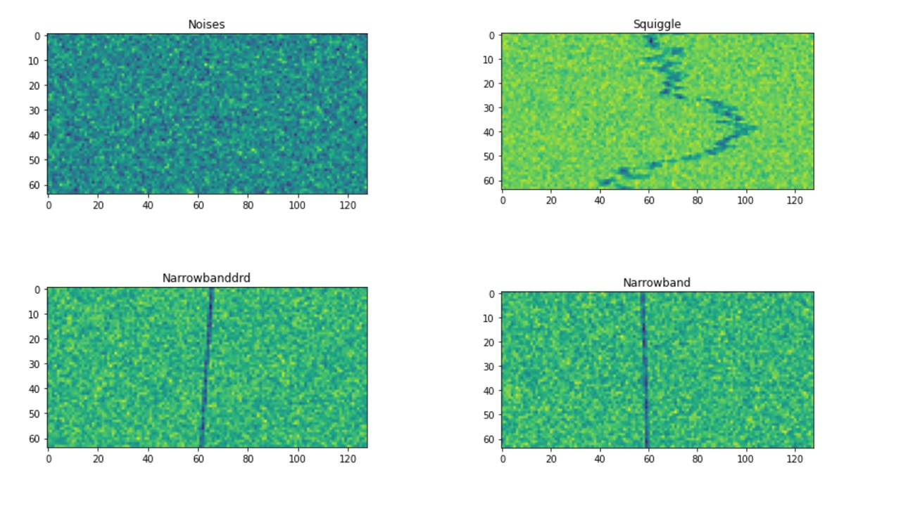
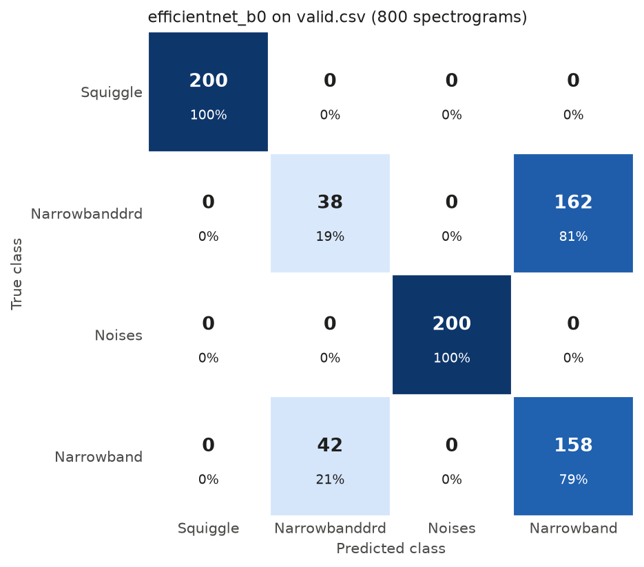

<h1 align="center">Radio Signals Classification</h1>

<p align="center">
  Sorting radio signal spectrograms into four signal types with a pretrained EfficientNet and SpecAugment, in PyTorch.
</p>

<p align="center">
  
  
  <a href="LICENSE"></a>
</p>

Each input is a 64 × 128 spectrogram (frequency against time) and the model has to say which kind of signal it contains. I built this in December 2024 while working through the Coursera guided project [Classify Radio Signals with PyTorch](https://www.coursera.org/projects/classify-radio-signals-with-pytorch), then started turning the notebook into scripts.

<p align="center">
  
</p>

> **Result:** after 10 epochs on CPU the best checkpoint gets 74.5% accuracy on the 800 validation spectrograms. Squiggle and Noises are always right; almost all errors are Narrowband and Narrowbanddrd mixed up with each other. See [Results](#results).

## Task and data

There are four classes: `Squiggle`, `Narrowband`, `Narrowbanddrd` and `Noises` (no signal). The images above show one of each.

The data comes as two CSV files from the guided project: `train.csv` with 3,200 examples and `valid.csv` with 800. Each row holds the 8,192 pixel values of one spectrogram (64 × 128, scaled to 0 to 1) and a `labels` column. The CSV files are not in this repository (`*.csv` is git-ignored), but a copy is on GitHub as 7z archives in [avikds/Radio-Signal-Classification-PyTorch](https://github.com/avikds/Radio-Signal-Classification-PyTorch/tree/main/data). Put `train.csv` and `valid.csv` in a `data/` folder at the root of this repository. Both sets are balanced: 800 examples per class in train, 200 in validation.

## Approach

`SpecDataset` reshapes each row into a 1 × 64 × 128 tensor and maps the four labels to 0 to 3. Training images then go through SpecAugment-style masking, with 4 time masks and 4 frequency masks, each up to 15 bins wide (`utils/spec_augment.py`). The validation set is left as is.

The model is `efficientnet_b0` from [timm](https://github.com/huggingface/pytorch-image-models) with ImageNet weights, a single input channel and a 4-class head, trained with cross-entropy. `config.py` holds the training settings: Adam with learning rate 0.001, batch size 128, 10 epochs and seed 42, on CPU. The loop keeps the weights with the lowest validation loss.

<p align="center">
  
</p>

*A training example after augmentation: the flat bands are the time and frequency masks.*

## Results

I trained with `python train.py` on CPU (6 threads, about 28 minutes for 10 epochs). Validation loss was lowest after epoch 5, and `python inference.py` evaluates those weights on the whole validation set:

| Validation set (800 spectrograms) | |
|---|---|
| Accuracy | 74.5% (596 / 800) |
| Cross-entropy loss | 0.364 |

| Class | Correct | Mistaken for |
|---|---|---|
| Squiggle | 200 / 200 | none |
| Noises | 200 / 200 | none |
| Narrowband | 158 / 200 (79%) | Narrowbanddrd (42) |
| Narrowbanddrd | 38 / 200 (19%) | Narrowband (162) |

<p align="center">
  
</p>

Every Squiggle and Noises spectrogram is classified correctly. For Narrowband and Narrowbanddrd, the model labels most of both as Narrowband and gets 196 of those 400 spectrograms right (49%), about what guessing between the two would give.

Training log, one line per epoch:

| Epoch | Train loss | Train acc | Valid loss | Valid acc |
|---|---|---|---|---|
| 1 | 1.243 | 70.0% | 2.560 | 29.5% |
| 2 | 0.424 | 74.1% | 0.547 | 68.2% |
| 3 | 0.386 | 75.5% | 1.008 | 66.5% |
| 4 | 0.380 | 73.9% | 0.390 | 74.4% |
| 5 | 0.364 | 76.8% | 0.380 | 75.9% |
| 6 | 0.382 | 77.1% | 0.419 | 77.8% |
| 7 | 0.365 | 76.9% | 0.382 | 74.0% |
| 8 | 0.356 | 77.8% | 0.414 | 70.3% |
| 9 | 0.354 | 77.6% | 0.394 | 72.3% |
| 10 | 0.357 | 78.3% | 0.538 | 67.4% |

These per-epoch numbers are averages over batches. The last validation batch has only 32 examples, so epoch 5 reads 75.9% and 0.380 here against 74.5% and 0.364 when `inference.py` counts every example.

The notebook trains a second model with the same settings. In my run its validation loss was again lowest after epoch 5, and those weights got 75.5% (604 / 800) with the same split: every Squiggle and Noises example right, Narrowband 179 / 200 and Narrowbanddrd 25 / 200.

## Status

The notebook and the scripts run end to end. I tested them with Python 3.12, PyTorch 2.15 (CPU), timm 1.0.30, NumPy 2.5 and pandas 3.1.

The open problem is telling Narrowband from Narrowbanddrd. I have not yet tried training longer or with a smaller learning rate, turning off the time masks, or feeding the model larger images.

## Run it

```bash
pip install torch torchvision timm pandas numpy matplotlib tqdm jupyter
```

Put `train.csv` and `valid.csv` in `data/`, then run from the root of the repository:

```bash
python train.py
python inference.py
```

`train.py` trains for 10 epochs and saves the best weights to `efficientnet_b0-best-weights.pt`. `inference.py` loads them, prints accuracy, loss and per-class counts for `valid.csv`, and writes `media/confusion-matrix.png`.

The notebook has the same steps in one file. Open `notebooks/Radio Signals Classification.ipynb` from the `notebooks/` folder and run all cells. It reads the CSV files from `../data/` and imports the helpers in `utils/`.

## Repository layout

```
├── notebooks/
│   └── Radio Signals Classification.ipynb   # data, augmentation, model and training loop
├── dataset/dataset.py                       # SpecDataset
├── models/classifier.py                     # EfficientNet wrapper
├── utils/
│   ├── spec_augment.py                      # TimeMask, FreqMask and time warping
│   ├── sparse_image_warp.py
│   └── utils.py                             # accuracy, confusion matrix and plotting helpers
├── data/                                    # train.csv and valid.csv (not tracked)
├── config.py                                # paths and hyperparameters
├── train.py, trainer_api.py                 # training script and loop
├── inference.py                             # validation metrics and confusion matrix
├── ressources/                              # torchaudio feature augmentation tutorial
└── media/                                   # images used in this README and the notebook
```

## Credits

- Coursera guided project [Classify Radio Signals with PyTorch](https://www.coursera.org/projects/classify-radio-signals-with-pytorch), which provides the task and the data.
- D. S. Park et al., [SpecAugment: A Simple Data Augmentation Method for Automatic Speech Recognition](https://arxiv.org/abs/1904.08779), 2019, and the Google Research [blog post](https://research.google/blog/specaugment-a-new-data-augmentation-method-for-automatic-speech-recognition/) about it.
- Ross Wightman's [PyTorch Image Models (timm)](https://github.com/huggingface/pytorch-image-models) for the pretrained EfficientNet.
- `ressources/audio_feature_augmentation_torchaudio.ipynb` is a copy of the PyTorch tutorial [Audio Feature Augmentation](https://pytorch.org/audio/main/tutorials/audio_feature_augmentation_tutorial.html) by Moto Hira.

The code is released under the [MIT License](LICENSE).
