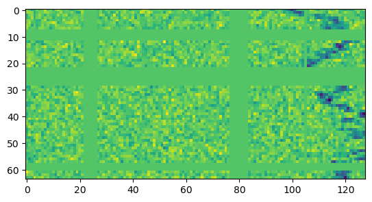

<h1 align="center">Radio Signals Classification</h1>

<p align="center">
  Sorting radio signal spectrograms into four signal types with a pretrained EfficientNet and SpecAugment, in PyTorch.
</p>

<p align="center">
  
  
  <a href="LICENSE"></a>
</p>

Each input is a 64 × 128 spectrogram (frequency against time) and the model has to say which kind of signal it contains. I built this in December 2024 while working through the Coursera guided project [Classify Radio Signals with PyTorch](https://www.coursera.org/projects/classify-radio-signals-with-pytorch), then started turning the notebook into scripts.

<p align="center">
  
</p>

> **Status:** the data pipeline, augmentation and model are in place, but the model has not been trained to the end yet, so there are no scores to report. See [Status](#status) for what is left.

## Task and data

There are four classes: `Squiggle`, `Narrowband`, `Narrowbanddrd` and `Noises` (no signal). The images above show one of each.

The data comes as two CSV files from the guided project: `train.csv` with 3,200 examples and `valid.csv` with 800. Each row holds the 8,192 pixel values of one spectrogram (64 × 128, scaled to 0 to 1) and a `labels` column. The CSV files are not in this repository (`*.csv` is git-ignored), so you need to get them from the project.

## Approach

- **Dataset.** `SpecDataset` reshapes each row into a 1 × 64 × 128 tensor and maps the four labels to 0 to 3.
- **Augmentation.** Training images go through SpecAugment-style masking: 4 time masks and 4 frequency masks, each up to 15 bins wide (`utils/spec_augment.py`). The validation set is left as is.
- **Model.** `efficientnet_b0` from [timm](https://github.com/huggingface/pytorch-image-models), with ImageNet weights, a single input channel and a 4-class head, trained with cross-entropy.
- **Training setup** (`config.py`). Adam, learning rate 0.001, batch size 128, 10 epochs, on CPU. The loop keeps the weights with the lowest validation loss.

<p align="center">
  
</p>

*A training example after augmentation: the flat bands are the time and frequency masks.*

## Status

The notebook runs through data loading, augmentation and model creation. Training stops at the first epoch with a `TypeError`, because the `fit` loop calls `train_fn` a second time where it should call `eval_fn` on the validation loader. `eval_fn` also puts the model in training mode instead of `model.eval()`.

The scripts (`train.py`, `trainer_api.py`, `models/`, `dataset/`, `utils/`) are an unfinished port of the notebook and do not run yet: `config` is imported as a module but read like a dictionary, a few imports are missing, and `inference.py` only holds an import.

## Run it

```bash
pip install torch torchvision timm pandas numpy matplotlib tqdm jupyter
```

Put `train.csv` and `valid.csv` next to the notebook, along with `utils/spec_augment.py`, `utils/sparse_image_warp.py` and `utils/utils.py`, which the notebook imports as top-level modules. Then open `notebooks/Radio Signals Classification.ipynb` and run the cells in order. Training will run once the `fit` loop is fixed as described above.

## Repository layout

```
├── notebooks/
│   └── Radio Signals Classification.ipynb   # data, augmentation, model and training loop
├── dataset/dataset.py                       # SpecDataset
├── models/classifier.py                     # EfficientNet wrapper
├── utils/
│   ├── spec_augment.py                      # TimeMask, FreqMask and time warping
│   ├── sparse_image_warp.py
│   └── utils.py                             # accuracy and plotting helpers
├── config.py                                # paths and hyperparameters
├── train.py, trainer_api.py, inference.py   # script version (work in progress)
├── ressources/                              # torchaudio feature augmentation tutorial
└── img/, media/                             # images used in this README
```

## Credits

- Coursera guided project [Classify Radio Signals with PyTorch](https://www.coursera.org/projects/classify-radio-signals-with-pytorch), which provides the task and the data.
- D. S. Park et al., [SpecAugment: A Simple Data Augmentation Method for Automatic Speech Recognition](https://arxiv.org/abs/1904.08779), 2019, and the Google Research [blog post](https://research.google/blog/specaugment-a-new-data-augmentation-method-for-automatic-speech-recognition/) about it.
- Ross Wightman's [PyTorch Image Models (timm)](https://github.com/huggingface/pytorch-image-models) for the pretrained EfficientNet.
- `ressources/audio_feature_augmentation_torchaudio.ipynb` is a copy of the PyTorch tutorial [Audio Feature Augmentation](https://pytorch.org/audio/main/tutorials/audio_feature_augmentation_tutorial.html) by Moto Hira.

The code is released under the [MIT License](LICENSE).
